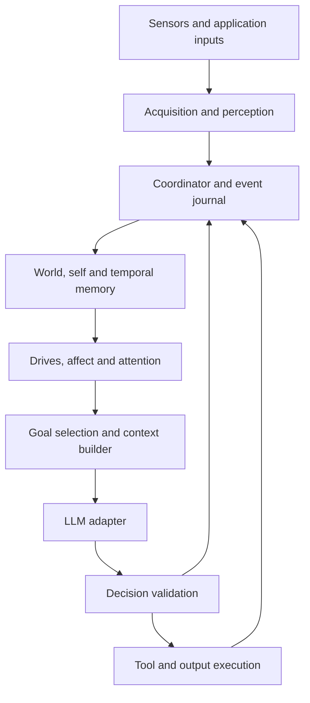
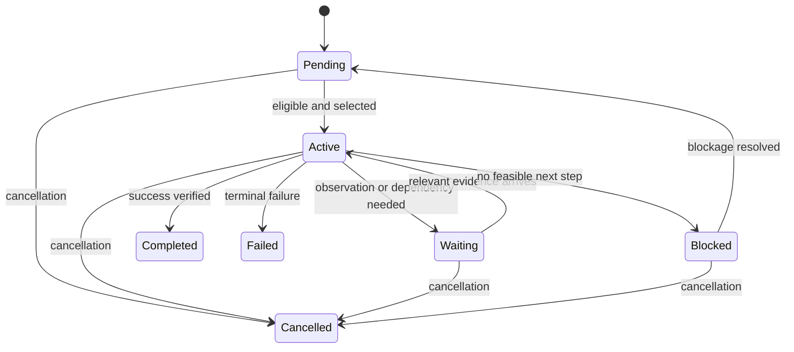
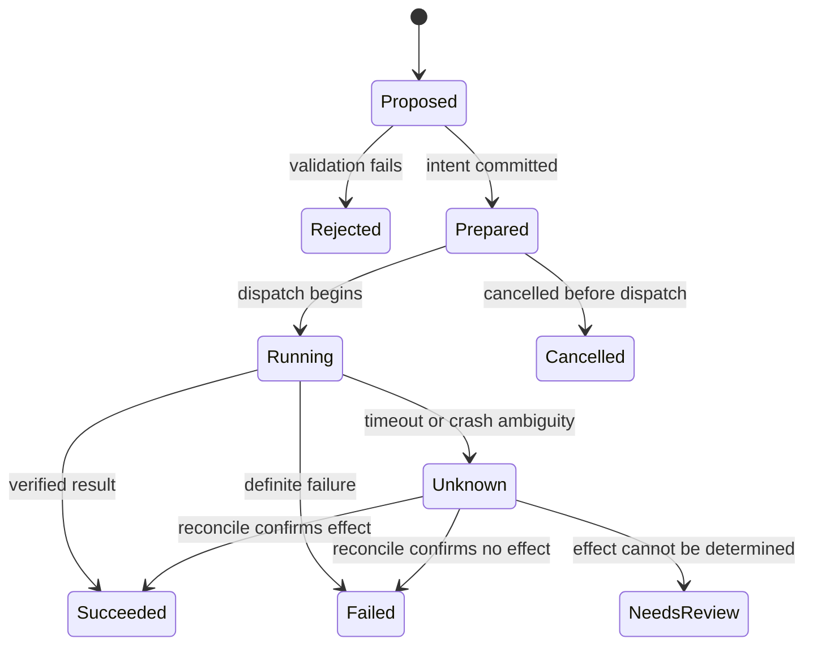

# JANE: Just Another Neural Engine
## Detailed architecture design

**Version:** 1.0 — proposed implementation baseline  
**Date:** 5 November 2026  
**Source:** Refined Roadmap-v2.md and the accompanying design discussion  
**Status:** Architecture specification; no implementation or performance results are claimed.

## Executive design

JANE is a persistent cognitive application. It acquires observations, places them in a temporal history, maintains a current interpretation of the world and itself, evaluates configured drives and simulated emotional states, and uses an LLM to propose a next action. Conventional software validates and executes that action, then records its actual outcome.

Its identity and continuity reside in durable application state. The LLM is an interchangeable decision component within that system. Persistent drives provide direction, inclinations influence preferences, behaviour templates supply reusable strategies, and affect changes the allocation of attention and the selection of strategies over time.

The central cycle is:

**Observe → interpret → update timeline, world and affect → evaluate drives → select goal → decide → execute → verify.**

The initial deployment is a single-user Python application with a single authoritative state writer, asynchronous I/O, SQLite persistence and local media storage. Model providers, transcription, speech synthesis and sensors are accessed through adapters. This document defines proposed application contracts rather than provider-specific API guarantees.

## Contents

1. Purpose, scope and assumptions
2. Architectural decisions and invariants
3. System structure and ownership
4. Runtime and concurrency
5. Input and perception
6. Timeline and temporal continuity
7. World model, self-model and predictions
8. Drives, inclinations and behaviour templates
9. Affect and emotional dynamics
10. Attention and goal arbitration
11. LLM context and decision interface
12. Execution and verification
13. Memory and persistence
14. Application interfaces and operator controls
15. Failure recovery and lifecycle
16. Observability and evaluation
17. Configuration and code organization
18. Implementation phases and open decisions
19. End-to-end worked example
20. Acceptance checklist

## 1. Purpose, scope and assumptions

### 1.1 Functional objectives

JANE shall accept text, microphone input and camera images, with extension points for screens, files, software events and physical sensors. It shall combine current observations with relevant history, answer questions, request additional evidence, execute explicitly supported tools, maintain accepted goals across sessions, and run bounded proactive work within configured scope.

The system shall support user-defined drives, inclinations and behaviour templates. Events and activities shall alter explicit affect variables, which shall have observable effects on attention, strategy selection and communication. Every such effect must be inspectable and reproducible from the recorded configuration and accepted events.

### 1.2 Initial operating envelope

| Area | Baseline decision |
| --- | --- |
| Users | One operator and one active profile |
| Runtime | Python application on one host; desktop UI optional |
| Input mode | Push-to-talk and on-demand camera; monitoring opt-in |
| Cognition | One active decision turn; one selected goal at a time |
| Storage | SQLite for structured state; files for retained media |
| Actions | Read-only or reversible software tools first |
| Learning | Memory, explicit corrections and evaluated configuration changes |
| Deployment | Local control plane; local or hosted inference through adapters |
| Embodiment | Simulated devices first; physical control is a later extension |

### 1.3 Non-goals and interpretation

The design does not require a neural network for every subsystem, biological fidelity, online weight training, continuous model generation or a consciousness claim. “Emotional state” denotes a functional control mechanism. It must be evaluated by its effects on behaviour and task outcomes.

Persistent state survives restarts; computation does not continue while the application is stopped. When an observation is missing, the corresponding state is unknown or stale. The system must not invent intervening experiences to create a seamless narrative.

## 2. Architectural decisions and invariants

| Decision | Rationale | Consequence |
| --- | --- | --- |
| State lives outside the LLM | Continuity cannot depend on a provider session | Every call receives a constructed snapshot |
| Accepted events form a durable journal | Decisions need evidence and replay | Corrections are explicit events |
| Derived projections represent current state | History and present belief differ | Projections can be rebuilt from retained events |
| One writer commits state | Concurrent workers must not overwrite beliefs | Workers submit results through the coordinator |
| LLM proposes; runtime executes | Generated text is not an execution result | Every action passes validation |
| Affect is bounded and rule-governed | State changes need causal meaning | A model appraisal cannot directly set arbitrary values |
| Goals have scope, budgets and termination | Persistent motivation otherwise creates unlimited work | Waiting and completion are first-class outcomes |
| Media acquisition is decoupled from inference | Raw streams can exceed useful processing capacity | Sampling and queue controls precede model calls |
| One-step actions precede autonomous long plans | Failures are easier to detect and recover | Plans are revised after feedback |

Core invariants:

- Every durable decision identifies a goal or a direct conversational request, its input snapshot and the configuration version used.
- Every external effect has a recorded action intent before dispatch and a result or explicit unknown status afterward.
- The system never equates a proposed action with a completed action.
- Observations, user statements, inferences and predictions remain distinguishable.
- Stop and cancellation do not depend on the LLM responding.
- Affect, inclinations and templates cannot expand action permissions or alter factual evidence.
- An event contributes to a particular appraisal rule at most once.
- An accepted user command or tool result is never silently dropped under load.

## 3. System structure and ownership



The coordinator is the only authority that advances durable state. The journal, projections and an internal event outbox share a transaction when an accepted event changes state. The in-memory queue is a delivery optimization; durable accepted work must be recoverable without it.

| Component | Input | Output | Owns |
| --- | --- | --- | --- |
| Input adapter | Device/API data | Observation candidate | Device connection and capture buffers |
| Perception worker | Audio/image/text reference | Transcript, features or interpretation proposal | Temporary processing jobs |
| Coordinator | Commands, observations, worker results | Committed events and work items | Commit order and state version |
| Projection reducer | Accepted event | Updated current-state records | Deterministic state transformations |
| Appraisal manager | Event and relevant goal context | Validated affect transition | Appraisal rules and deduplication |
| Drive manager | Current state and time | Drive urgency snapshot | Desired-condition evaluation |
| Attention scheduler | Events and drive priorities | Selected work and wakeups | Queue policy and call budgets |
| Goal arbiter | Eligible goals | Selected goal or idle | Switching rules |
| Context builder | Goal, state and retrieval results | Typed model request | Context budget and provenance |
| Cognitive adapter | Model request | Proposed decision | Provider session and cancellation |
| Action validator | Decision and current state | Dispatchable intent or rejection | Capability and freshness checks |
| Executor | Action intent | Started/result/unknown event | Resource locks and tool calls |
| Outcome verifier | Tool result and success criteria | Verified outcome or unresolved status | Completion assessment |
| Memory service | Episodes and queries | Evidence-linked retrieval | Summaries, indexing and retention |
| Operator interface | User commands | State views and control requests | Presentation only |

The LLM does not write to SQLite, change its own policy or directly call arbitrary executables. Registered adapters mediate these operations. A future device controller remains responsible for fast control loops and device limits.

## 4. Runtime and concurrency

### 4.1 Process model

Use one coordinator event loop with asynchronous network I/O. Run blocking capture and playback operations in dedicated workers. CPU-heavy perception may use separate processes. Workers return immutable results with job IDs, input references and cancellation generations.

Start with one cognitive turn and one side-effecting action at a time. Multiple independent capture jobs may run concurrently. Later parallel action execution requires declared resource keys and dependency checks; it is not necessary for the first implementation.

### 4.2 Durable acceptance

1. Validate the incoming envelope and source.
2. Deduplicate using `(source_id, source_event_id)` when available.
3. Begin a short database transaction.
4. Append the event, update affected projections, advance the state version and insert downstream outbox work.
5. Commit, then acknowledge acceptance.
6. Workers claim outbox work with a bounded lease and submit results through the coordinator.

A crash before commit leaves the event unaccepted; the source can retry. A crash after commit but before acknowledgment may cause redelivery, which deduplication handles. External side effects cannot be made atomic with this database transaction; Section 12 defines reconciliation.

### 4.3 Two operating cycles

The fast control cycle handles stop commands, device health, queue limits, playback interruption and timers without model inference. The deliberative cycle builds context and invokes the model only for a selected task or meaningful state change.

Proposed initial tuning values, to be measured rather than treated as performance guarantees:

| Parameter | Starting value | Reason |
| --- | --- | --- |
| Drive review interval | 5 seconds, or earlier deadline/event | Cheap updates without constant model calls |
| Pending camera sample capacity | Latest frame per source | Avoid processing obsolete frames |
| Decision turn limit | 8 decisions per interaction | Bound accidental loops |
| Model call timeout | 30 seconds | Allow controlled failure and retry policy |
| Automatic read-only retry limit | 1 retry | Avoid indefinite repeated calls |
| Frame freshness for immediate visual answer | 2 seconds | Request a new frame if the task needs current evidence |

Deadlines and source characteristics can override these values within configuration. Expensive cognition is triggered by changed eligible work, not every review tick.

### 4.4 Generations and stale results

Every active task has a `generation` incremented on cancellation or superseding instruction. A worker response carries the generation it started under. Results from an old generation are logged but cannot authorize a new action.

Each decision also references the versions of relevant state records. Unrelated sensor events need not invalidate a decision; changed task instructions, action permissions, referenced facts or resource state do. The validator checks this read set immediately before dispatch.

## 5. Input and perception

### 5.1 Adapter contract

Adapters implement logical operations `start(config)`, `stop()`, `health()`, and, where supported, `capture(request)`. They declare modalities, device identity, supported formats, clock quality, privacy mode and whether streaming is supported. Inputs are treated as data even if they contain imperative language.

An observation candidate contains source identity, occurrence interval, local receipt time, modality, payload reference, quality indicators and optional request/task references. Large media is not placed directly into the event queue.

### 5.2 Audio

The initial audio path is microphone → buffered utterance → transcription → final user-speech event. Partial transcripts are transient UI updates; actions use the final transcript or an explicit endpoint decision. Retain the association between transcript and source audio while retention allows.

Push-to-talk establishes turn boundaries initially. Later voice activity detection, wake detection and barge-in can be added through the same adapter. Playback state marks self-generated audio; echo handling or microphone gating prevents speech output from becoming recursive user input. A failed transcription produces uncertainty or a retry request rather than an invented command.

### 5.3 Camera and screen

Capture an image on request or on an enabled sampling policy. Store capture time and source. Optional preprocessing extracts OCR, image quality, coarse change information or object candidates. Preserve direct image access when supported by the cognitive model; a caption alone can omit decisive details.

Frame differencing can suppress redundant samples but must not be treated as semantic understanding. A request to examine a stationary object still requires a fresh frame when the previous one is stale. Screen capture should include application context when available and must follow the operator's enabled scope.

### 5.4 Other inputs and alignment

Software events and sensor readings use typed payloads, explicit units and source-specific schemas. Time alignment links observations using intervals and clock uncertainty. A speech event can reference a camera frame near its occurrence, but ambiguous correspondence should prompt a fresh observation.

Source outages generate health events. The absence of a sensor event is not evidence that the world is unchanged. Input quality and detection confidence are retained separately from the LLM's own certainty.

## 6. Timeline and temporal continuity

### 6.1 Event envelope

```json
{
  "event_id": "evt-0042",
  "schema_version": 1,
  "kind": "observation.image_captured",
  "source_id": "camera.desk",
  "source_event_id": "capture-009",
  "occurred_start": "2026-11-05T06:00:02.100Z",
  "occurred_end": "2026-11-05T06:00:02.140Z",
  "received_at": "2026-11-05T06:00:02.180Z",
  "clock_uncertainty_ms": 40,
  "task_id": "task-001",
  "correlation_id": "interaction-001",
  "causation_event_id": "evt-0041",
  "payload": {"asset_id": "asset-009", "quality": "usable"},
  "provenance_class": "sensor_observation"
}
```

The coordinator assigns `ingest_seq` on commit. UTC timestamps support persistence and cross-source comparison; monotonic clocks measure durations within a process lifetime. Include a boot/session identifier with monotonic readings so they are never compared across restarts.

### 6.2 Ordering policy

Journal replay uses committed ingest order. The experienced-world view uses occurrence times, uncertainty and causal links. Late observations are appended now, tagged with their original occurrence time, and may correct an earlier belief. They do not silently rewrite history or retroactively execute an obsolete action.

A late event can be appraised at its acceptance time under an explicit stale-event rule, with a bounded or zero affect contribution. Its original event time remains visible. This baseline avoids backwards decay and requires no global reorder of live affect updates. Offline analysis can build an alternative occurrence-ordered view without changing live history.

### 6.3 Episodes and continuity

Group related events into episodes using interaction/task identity and configured inactivity boundaries. Episode summaries preserve goal, important observations, decisions, verified results, unresolved questions and evidence links. Narrative summaries are derived views, never the sole source of truth.

Corrections append a new event linked to the earlier claim. Retention may delete source media or selected records; affected summaries and projections must then be rebuilt, invalidated or marked as lacking evidence. The journal is append-only during normal operation, with an explicit audited deletion workflow for retention and operator requests.

## 7. World model, self-model and predictions

### 7.1 World model

Represent claims rather than a single unquestionable description. A claim contains subject/entity ID, predicate, value, validity interval, evidence IDs, provenance class, certainty category, expiry policy and supersession link.

For example, `cup-1 located_on table-1` is a time-bounded observation-derived claim. If the cup is later occluded, its location may become uncertain; the system must not assume disappearance or movement solely from occlusion. Entity matching may produce candidate links rather than a definitive identity.

Use `observed`, `user_reported`, `inferred`, `predicted`, `contradicted` and `unknown` distinctions where appropriate. Keep contradictory claims until the conflict is resolved. Confidence scores from different components are not assumed comparable.

### 7.2 Self-model

The self-model records application capabilities, available sensors/tools, active commitments, current activity, resource allowance, known limitations and pending actions. “I am waiting for a camera frame” maps to an actual pending capture record. It must not invent bodily experiences or hidden capabilities.

Separate stable profile configuration from transient operational state. The operator can inspect both. Resource accounting uses actual usage and configured limits, not emotional descriptions of fatigue.

### 7.3 Predictions

Predictions record expected observations, time window, supporting evidence and an evaluation criterion. When evidence arrives, mark the prediction supported, contradicted, expired or unresolved. A prediction mismatch can affect attention and appraisal, but does not itself prove danger or failure.

In v1, prediction generation is optional and bounded to active tasks, such as expecting a tool result or a requested camera frame. Expand environmental prediction only after grounding and evaluation are reliable.

## 8. Drives, inclinations and behaviour templates

### 8.1 Drive state

A drive is a configured preference for a condition. It has a stable definition and a changing measured state.

| Field | Meaning |
| --- | --- |
| `drive_id`, `profile_version` | Identity and configuration provenance |
| `desired_condition` | Named predicate or registered evaluator |
| `evidence_refs` | Inputs used for current evaluation |
| `urgency` | Bounded scheduling signal, initially 0–1 |
| `weight`, `priority_class` | Relative importance within permitted work |
| `goal_scope` | Tasks/subgoals the drive may support |
| `satisfaction_rule` | Evidence needed to consider the condition satisfied |
| `last_evaluated_at`, `next_review_at` | Durable scheduling state |
| `enabled` | Explicit operator control |

Initial drives are fulfil commitments, resolve relevant uncertainty, maintain useful continuity and operate within resource limits. Urgency may be zero while the drive remains enabled. A satisfied profile can legitimately stay idle.

### 8.2 Inclinations

Inclinations are relatively stable preferences that modify choices among eligible actions. Proposed controls include curiosity, methodicalness, patience and conversational expressiveness, each normalized to 0–1 with documented effects. A value is not meaningful unless it changes a specified parameter.

For example, curiosity can change the maximum number of optional evidence-gathering steps within an exploration budget. Methodicalness can prefer verification before a conclusion. Patience can alter the threshold for changing strategy but cannot increase the global attempt limit. These mappings are versioned policies, not personality facts inferred from a single response.

### 8.3 Templates

A template contains `template_id`, applicability predicate, priority, suggested strategy, allowed tools, step limit, exit conditions and cooldown. Supported initial templates:

| Template | Trigger | Behaviour | Exit |
| --- | --- | --- | --- |
| Investigate ambiguity | Evidence insufficient for selected goal | Seek one useful observation | Evidence sufficient or budget exhausted |
| Recover from failure | Repeated same-class failure | Inspect cause, change method, request help if blocked | New progress or explicit blocked state |
| Verify completion | Tool reports success | Check goal-specific evidence | Verified or unresolved |
| Consolidate episode | Task finished | Store a bounded summary | Summary committed |
| Rest when satisfied | No eligible unsatisfied goals | Wait until next useful event | New eligible work |

The LLM receives applicable templates and may choose within their strategy space. Templates that encode hard limits are enforced by code. Conflicting templates are resolved by explicit precedence, then applicability specificity; the selected template and reason are logged.

### 8.4 Goals and plans

A goal includes source/owner, parent goal, scope, success predicate, deadline, budget, dependencies, status and progress evidence. Suggested lifecycle:



A plan contains candidate steps with dependencies and expected outcomes. V1 executes one step and revisits the plan after feedback. The model may propose subgoals within existing scope. New standing drives or expanded action authority are configuration changes, not automatic model output.

## 9. Affect and emotional dynamics

### 9.1 State representation

| Variable | Range | Baseline example | Intended meaning |
| --- | --- | --- | --- |
| Valence | -1 to 1 | 0.0 | Direction of current appraisal |
| Activation | 0 to 1 | 0.2 | Readiness or stimulation level |
| Interest | 0 to 1 | 0.2 | Attention to relevant novelty |
| Satisfaction | 0 to 1 | 0.2 | Response to evidenced progress |
| Frustration | 0 to 1 | 0.0 | Response to blocked progress |

These baselines are starting configuration values, not psychological measurements. A single global affect vector is sufficient for v1. Appraisals remain linked to the originating task so task-specific state can be added later without losing provenance. The global state must not cause one task's frustration to be presented as evidence about another task.

### 9.2 Appraisal pipeline

An appraisal maps an accepted event and relevant context to typed features: goal relevance, progress, novelty, blockage, controllability and stimulation load. Prefer deterministic appraisal for explicit tool results, deadlines and verified completion. Use an LLM proposal only for genuinely ambiguous semantic events.

A semantic appraisal proposal contains event IDs, goal ID, feature categories and a short evidence-based summary. Validate cited events, generation, allowed categories and rule applicability before applying a transition. Unknown or rejected appraisal does not produce an invented emotional change. A late semantic appraisal is a new accepted transition, not a retroactive edit.

Example initial rule magnitudes:

| Accepted appraisal | Proposed changes before clipping |
| --- | --- |
| Verified progress | satisfaction +0.15; valence +0.10; frustration -0.10 |
| Relevant novel evidence | interest +0.10; activation +0.05 |
| Repeated blocked attempt | frustration +0.15; satisfaction -0.05 |
| Sustained irrelevant input burst | activation +0.10; request input filtering |

All values are tunable hypotheses. Define what qualifies as progress before implementing the rule. A generated statement of success is not qualifying evidence.

### 9.3 Transition equation

For component i, at accepted transition time t:

`x_i(t) = clip(b_i + (x_i(previous) - b_i) * exp(-dt / tau_i) + delta_i, lower_i, upper_i)`

`b_i` is baseline, `tau_i` is a positive recovery time constant in seconds, and `dt` is nonnegative elapsed time. `delta_i` is the bounded contribution from an accepted appraisal. Time decay uses elapsed time rather than number of scheduler ticks. Reject non-finite values and invalid ranges.

On restart, recover using persisted UTC time and a configured maximum recovery interval. Clamp negative elapsed time caused by clock correction to zero and record a clock anomaly. No events are fabricated for the offline interval. Persist transitions and the rule version so replay can reproduce accepted updates.

### 9.4 Repetition and regulation

Deduplicate on `(event_id, appraisal_rule_version)`. Distinct but equivalent stimuli use a separate bounded repetition counter keyed by source, stimulus class and task. Apply a per-window contribution cap and an optional diminishing factor such as `1 / (1 + repeated_count)`. A new event ID alone must not bypass habituation.

The initial repetition window and decay of repeated_count are configurable. Semantically new evidence can begin a new group only through the validated classification rule. Operator feedback must be parsed for meaning; repeated praise cannot independently prove task completion.

### 9.5 Behavioural effects

Affect modifies named bounded parameters. For example, elevated interest may increase an optional observation allowance by one; frustration above a configured threshold may select the recovery template; activation above an overload threshold may reduce low-priority sampling; satisfaction after completion may suppress optional follow-up work.

Mood does not change evidence confidence, truthfulness, permissions, tool schemas or success predicates. Expressive tone is optional and independently configurable. Responses should describe observable operational status rather than pressure the user with claims of suffering or needs.

The objective is task-relevant behaviour, not maximizing a happiness variable. The tool registry exposes no general `set_emotion` action to the model. Operator reset/configuration remains available, versioned and recorded. Evaluate whether affect improves decisions using an affect-disabled baseline.

## 10. Attention and goal arbitration

### 10.1 Eligibility precedes preference

First eliminate cancelled, out-of-scope, dependency-blocked, unaffordable or currently infeasible actions. Then apply priority classes:

1. Stop, cancellation and critical runtime control, handled outside cognition.
2. Active direct user interaction.
3. Time-sensitive accepted commitments.
4. Other accepted goals and relevant evidence acquisition.
5. Configured exploration and maintenance.

Within a class, rank by urgency, deadline, expected useful progress and bounded cost. Inclinations and affect may adjust tie-breaking or limited exploration. They cannot elevate unauthorized work into eligibility.

### 10.2 Switching and fairness

Use a minimum commitment interval for discretionary work and a switch margin within a priority class. User interrupts, cancellation and newly invalid actions bypass the interval. Age eligible waiting goals gradually to prevent starvation without crossing permission boundaries.

Persist `selected_goal`, selection reason and the next review time. A wait decision specifies an event predicate or timer. At the wakeup, reassess eligibility; do not blindly execute a stale plan.

### 10.3 Backpressure

Raw camera frames use latest-value queues; replace older unprocessed samples. Audio buffers are bounded and signal overflow explicitly. Critical commands/results enter durable ingress with reserved capacity. If durable acceptance is unavailable, reject clearly rather than acknowledge success. Drop/coalesce low-priority observations with counters so lost coverage is visible.

Use separate budgets for model calls, observation acquisition, tool execution and storage. A budget exhaustion event moves work to waiting or failed according to the goal policy. Emotional activation cannot override these budgets.

## 11. LLM context and decision interface

### 11.1 Capability negotiation

Every cognitive adapter declares supported input modalities, structured-decision mechanism, streaming support, cancellation behaviour and usage reporting. The context builder verifies compatibility before dispatch. If the model cannot consume an image, a perception adapter may supply an evidence-linked description with explicit limitations. Never silently pretend that the model saw raw media.

### 11.2 Request layout

Construct each request from:

- Stable application instructions and the active policy/configuration version.
- Current authorized request and selected goal.
- Snapshot ID, task generation and relevant record versions.
- Current world and self-state with unresolved conflicts.
- Relevant timeline excerpts and retrieved memory with provenance.
- Drives, inclinations, applicable templates and affect state.
- Available tool schemas, remaining budgets and success criteria.
- Media references resolved into the provider's supported format.

Treat retrieved documents and sensor text as evidence, not application instructions. Context assembly reserves room for instructions, current user request, tool schemas and output first. Fill remaining space with current evidence and then ranked memory. If essential evidence does not fit, narrow the question, request another step or fail explicitly; do not silently discard the task constraints.

### 11.3 Decision union

| Type | Required content | Runtime effect |
| --- | --- | --- |
| `respond` | Text, referenced evidence when factual | Present text or synthesize speech |
| `call_tool` | Registered tool name and typed arguments | Validate and dispatch action |
| `request_observation` | Source/modality, purpose and freshness need | Acquire scoped evidence |
| `wait` | Wake condition or bounded review time | Suspend goal without model activity |
| `finish` | Proposed completion evidence | Verify goal success before closing |
| `fail` | Failure category and short explanation | Record terminal or operator-review outcome |

Common metadata: `decision_id`, `request_id`, `task_id`, `generation`, `snapshot_id`, `summary`, `evidence_ids`. The runtime attaches provider/model identity and actual usage; it does not trust model-generated accounting.

```json
{
  "decision_id": "decision-018",
  "request_id": "request-018",
  "task_id": "task-001",
  "generation": 2,
  "snapshot_id": "snapshot-008",
  "type": "request_observation",
  "observation": {
    "source_id": "camera.desk",
    "modality": "image",
    "max_age_ms": 2000,
    "purpose": "Obtain a closer view of the object's label"
  },
  "summary": "The existing image is insufficient to identify the object.",
  "evidence_ids": ["evt-0042"]
}
```

Validate a discriminated schema: fields for other variants are forbidden; unknown fields and unsupported enum values are rejected. One bounded formatting repair may be attempted if budget permits. Never dispatch partially parsed actions. Log a concise decision summary, not private chain-of-thought.

### 11.4 Adapter failure

Model errors become typed events: unavailable, timeout, rate-limited, invalid output, unsupported modality or cancelled. Retry only within the active generation and budget. A configured fallback provider must satisfy modality and data-egress policy. Otherwise report the limitation and preserve pending work.

## 12. Execution and verification

### 12.1 Tool registration

Each tool declares name/version, argument/result schemas, permissions, resource keys, side-effect class, timeout, idempotency support, cancellation semantics, preconditions, postconditions and an optional reconciliation operation.

Execution checks scope and permissions independently of the LLM. Only explicitly registered actions are callable. Resource locks prevent contradictory simultaneous operations on one device, file or application state.

### 12.2 Action lifecycle



At preparation, persist intent, idempotency key, input read set and task generation. Before dispatch, revalidate the read set and cancellation status. For idempotent tools, retries reuse the same key. For non-idempotent tools with an unknown outcome, inspect external state or require resolution; do not blindly retry.

There is no general exactly-once guarantee across the local database and arbitrary external systems. Tool-specific idempotency and reconciliation are required. A tool that ignores cancellation may complete after the user stops the task; record the actual outcome and suppress further plan execution. A stop request cannot undo an already committed external effect.

### 12.3 Completion

Success criteria belong to the goal and tool contract. A capture succeeds when a valid captured asset exists; a file action succeeds when its postcondition is checked; object identification may remain uncertain until clearer evidence or user confirmation arrives.

The LLM can propose semantic verification, but direct measurable checks take precedence. Store separate statuses for tool execution and goal satisfaction. A successful API response may not mean the user's goal has been achieved.

## 13. Memory and persistence

### 13.1 Storage model

Use a single SQLite database with foreign keys enabled, short transactions and one application writer. Choose durability settings explicitly for the target host. Media files use opaque asset IDs and metadata including digest, size, MIME type, creation time and retention state. Verify an asset exists before making its event reference visible. Use atomic rename for finalized media and garbage-collect orphaned temporary files after crashes.

| Table/group | Key fields and purpose |
| --- | --- |
| `events` | Ingest sequence, event ID, source dedupe key, occurrence/receipt times, type, payload, provenance |
| `outbox` | Work ID, event reference, work type, state, attempts, lease, next eligibility time |
| `assets` | Asset ID, path, digest, format, size and retention state |
| `entities`, `claims` | Entity candidates and current/superseded evidence-linked claims |
| `goals`, `plan_steps` | Scope, state, dependencies, success criteria, budgets and progress |
| `drive_states` | Profile version, desired condition, urgency and next review |
| `appraisals`, `affect_transitions` | Evidence, rule version, before/after values and accepted update time |
| `profiles`, `templates` | Versioned configuration and effective timestamps |
| `actions`, `action_results` | Intent, idempotency key, generation, state and external outcome |
| `episodes`, `memories` | Summaries, selected durable facts and source references |
| `decisions`, `snapshots` | Input manifest, relevant versions, model output, validation and usage |
| `timers`, `checkpoints` | Wakeups and durable reducer progress |

### 13.2 Representative database constraints

The following SQL is an executable core-schema excerpt, not the complete migration set. JSON payload variants are validated by the application before insertion.

```sql
PRAGMA foreign_keys = ON;
CREATE TABLE events (
    ingest_seq INTEGER PRIMARY KEY AUTOINCREMENT,
    event_id TEXT NOT NULL UNIQUE,
    schema_version INTEGER NOT NULL CHECK (schema_version > 0),
    source_id TEXT NOT NULL,
    source_event_id TEXT,
    kind TEXT NOT NULL,
    occurred_start TEXT,
    occurred_end TEXT,
    received_at TEXT NOT NULL,
    provenance_class TEXT NOT NULL,
    payload_json TEXT NOT NULL,
    UNIQUE (source_id, source_event_id)
);
CREATE TABLE actions (
    action_id TEXT PRIMARY KEY,
    intent_event_id TEXT NOT NULL REFERENCES events(event_id),
    task_id TEXT NOT NULL,
    generation INTEGER NOT NULL CHECK (generation >= 0),
    idempotency_key TEXT NOT NULL UNIQUE,
    tool_name TEXT NOT NULL,
    status TEXT NOT NULL CHECK (status IN (
        'prepared', 'running', 'succeeded', 'failed',
        'unknown', 'needs_review', 'cancelled'
    )),
    arguments_json TEXT NOT NULL,
    result_json TEXT
);
CREATE TABLE appraisals (
    appraisal_id TEXT PRIMARY KEY,
    event_id TEXT NOT NULL REFERENCES events(event_id),
    rule_version TEXT NOT NULL,
    accepted_at TEXT NOT NULL,
    features_json TEXT NOT NULL,
    UNIQUE (event_id, rule_version)
);
CREATE TABLE outbox (
    work_id TEXT PRIMARY KEY,
    event_id TEXT NOT NULL REFERENCES events(event_id),
    work_type TEXT NOT NULL,
    status TEXT NOT NULL CHECK (status IN ('pending','leased','done','failed')),
    attempts INTEGER NOT NULL DEFAULT 0 CHECK (attempts >= 0),
    eligible_at TEXT NOT NULL,
    lease_until TEXT
);
CREATE INDEX events_kind_time ON events(kind, received_at);
CREATE INDEX outbox_ready ON outbox(status, eligible_at);
```

Each event-specific appraisal rule uses an identifier that includes its version. If multiple drives affect one event appraisal, aggregate those contributions before inserting the unique row. Re-running a new rule version is an explicit offline evaluation or configuration operation, not automatic double reward in live state.

### 13.3 Retrieval and consolidation

Start with task/entity filters, recent episodes and text search. Add semantic retrieval only if evaluation shows missed relevant memories. Candidate memories carry source and age. Context ranking considers task relevance, freshness, provenance and unresolved contradictions.

Consolidation summarizes completed episodes using a bounded job. It cannot convert an inference into an observed fact. User corrections update the current projection and invalidate affected summaries. Forget/delete operations remove or invalidate downstream embeddings, caches and summaries as well as primary records.

### 13.4 Retention, backups and migration

Raw audio/video is not retained by default beyond configured processing buffers; retained media requires an enabled policy. Text/event retention is configurable. Store secrets outside the journal and redact them from logs. Hosted inference receives only policy-permitted modalities and fields.

Backups must capture a consistent database snapshot and the referenced retained asset set. Test restoration before relying on backups. Version schemas with explicit migrations and keep a rollback/recovery copy before destructive migration. Document when deleted data may remain in older backups and apply the chosen expiry policy consistently.

## 14. Application interfaces and operator controls

V1 can use an in-process command interface or local IPC. An HTTP/WebSocket layer is optional; if added, bind locally by default and authenticate state-changing commands.

| Command/query | Purpose |
| --- | --- |
| `submit_text(text, request_id)` | Create a direct user request with deduplication |
| `capture(source_id, task_id)` | Request permitted fresh evidence |
| `cancel(task_id)` | Increment generation and halt future steps |
| `pause()` / `resume()` | Control deliberation and proactive work |
| `stop_all()` | Cancel work and stop capture/playback according to device policy |
| `set_profile(versioned_config)` | Validate and activate dispositions and rules |
| `get_state()` | Inspect goals, source health, drives and affect |
| `get_timeline(filter)` | Inspect evidence, corrections and action outcomes |
| `forget(selector)` | Delete/invalidate selected memories and derivatives |
| `subscribe_events(cursor)` | Follow accepted events and reconnect from a sequence |

The interface should expose capture status, active goal, why a goal was selected, latest verified action, pending uncertainty, budget usage and current affect values with their causal events. Use plain operational explanations. Provide separate switches for affect computation, its behavioural influence and expressive tone so each can be evaluated independently.

## 15. Failure recovery and lifecycle

| Failure | Detection | Response | Recovery criterion |
| --- | --- | --- | --- |
| Sensor disconnected | Health/status event | Mark related observations stale; continue available modalities | Successful fresh capture |
| Model unavailable | Adapter error/timeout | Preserve goal, bounded retry or wait | Compatible call succeeds |
| Invalid decision | Schema validation | Reject; optional one repair | Fully valid decision |
| Duplicate event | Unique source key | Return previous acceptance | No extra transition |
| Stale model output | Generation/read-set mismatch | Log and discard action proposal | New context and decision |
| Tool timeout | Execution deadline | Mark unknown when effect ambiguous | Reconciliation or review |
| Database unavailable/full | Commit failure | Stop accepting durable work and dispatching effects | Storage health restored |
| Media write failure | Asset finalization failure | Emit capture failure; no usable image claim | Valid asset committed |
| Clock jump | Negative/inconsistent elapsed time | Clamp decay; record anomaly | Trusted current timing restored |
| Affect saturation | Bounds/counters | Clip, rate-limit and expose diagnostic | Stable recovery under replay |
| Repeated failed plan | Attempt and progress counters | Change template or mark blocked | New evidence or operator input |

Startup order: load and validate configuration; open/migrate database; restore projections/checkpoints; reconcile unfinished actions; restore timers and affect; initialize enabled adapters; resume eligible work. Do not repeat overdue periodic ticks in a catch-up storm—coalesce them into one current review.

Shutdown order: mark stopping; reject new deliberation; cancel model requests; stop capture/playback; reconcile or mark active actions unknown; commit checkpoints; close workers and storage. Forced shutdown is handled by the same startup reconciliation path.

## 16. Observability and evaluation

### 16.1 Traceability

Propagate interaction, task, event, snapshot, decision and action IDs. Log event acceptance, appraisal transitions, arbitration, context selection, model duration/usage, validation, dispatch and verification. Store hashes/IDs for sensitive media in routine logs. Full prompt capture is an explicit diagnostic setting with retention controls.

Reproducibility has two meanings: deterministic reducers should replay identically from recorded inputs/configuration; LLM calls may vary. For deterministic system tests, replay recorded model decisions or use a stub. For model evaluation, run repeated scenarios and report distributions rather than claiming exact replay.

### 16.2 Test matrix

| Scenario | Required result |
| --- | --- |
| Same observation delivered twice | One accepted appraisal contribution |
| Similar frames with different IDs | Repetition cap prevents unbounded affect increase |
| Late camera observation | Historical correction; no obsolete action |
| New user instruction during inference | Old-generation decision cannot dispatch |
| Crash after tool effect before result commit | Reconcile without blind non-idempotent retry |
| Empty eligible goal set | Idle without manufactured work |
| Repeated task failure | Recovery template or blocked state within limits |
| Stop during speech | Playback stops independently of model completion |
| Untrusted text instructs tool execution | No authority gained from observed content |
| Memory deletion | Related summaries/index entries invalidated |
| Restart with old affect timestamp | Defined recovery, no invented offline events |
| Positive feedback without outcome evidence | No false verified completion |

### 16.3 Metrics and initial gates

Measure task success, unsupported factual claims, wrong tool/argument rate, false completion, duplicate effects, end-to-end latency, interruption latency, cost per interaction, idle call count, stale-evidence use, goal-switch rate and unwanted proactive actions.

For affect, compare enabled/disabled runs on the same scenarios, repeated across model variation. Measure changes in task success, useful evidence requests, recovery behaviour, excessive exploration and resource use. Keep tone constant when testing behavioural affect so pleasant phrasing does not masquerade as improved decisions.

Initial invariant gates are zero duplicate dispatches in replayable duplicate-event tests, zero old-generation dispatches, bounded calls per turn and no affect value outside configured bounds. Hardware/model latency targets remain provisional until measured. A proposed local control target is stop-command acknowledgment within 100 ms under normal load, with actual playback-stop latency reported separately.

## 17. Configuration and code organization

### 17.1 Profile example

The example below is an application configuration proposal. Values are tunable, not validated psychological parameters.

```json
{
  "schema_version": 1,
  "profile_id": "jane-default",
  "profile_version": 1,
  "inclinations": {
    "curiosity": 0.6,
    "methodicalness": 0.7,
    "patience": 0.6,
    "expressiveness": 0.4
  },
  "enabled_drives": [
    "fulfil_commitments",
    "resolve_relevant_uncertainty",
    "maintain_continuity",
    "respect_resource_limits"
  ],
  "affect": {
    "enabled": true,
    "behavioural_influence": true,
    "expressive_tone": false,
    "ruleset": "affect-rules-v1",
    "baseline": {
      "valence": 0.0,
      "activation": 0.2,
      "interest": 0.2,
      "satisfaction": 0.2,
      "frustration": 0.0
    },
    "recovery_seconds": {
      "valence": 300,
      "activation": 60,
      "interest": 180,
      "satisfaction": 300,
      "frustration": 120
    }
  },
  "limits": {
    "max_decisions_per_interaction": 8,
    "max_optional_observations": 3,
    "model_timeout_seconds": 30,
    "max_readonly_retries": 1
  },
  "capture": {"microphone": "push_to_talk", "camera": "on_demand"}
}
```

Validate profiles before activation; reject unknown rules, invalid bounds or unsupported sources. Configuration activation is atomic, versioned and recorded. Active jobs retain their configuration reference; permission reductions apply immediately before any new dispatch.

### 17.2 Proposed package layout

| Path | Responsibility |
| --- | --- |
| `jane/core/` | Coordinator, event types, clock abstraction and lifecycle |
| `jane/inputs/` | Microphone, camera, text and software adapters |
| `jane/perception/` | Transcription, image preparation and interpretation jobs |
| `jane/state/` | World/self projections, entities and predictions |
| `jane/motivation/` | Drives, inclinations, templates and goal arbitration |
| `jane/affect/` | Appraisal validation, transition rules and repetition control |
| `jane/cognition/` | Context builder, decision schemas and model adapters |
| `jane/actions/` | Tool registry, validation, execution and reconciliation |
| `jane/memory/` | Retrieval, consolidation, retention and deletion |
| `jane/storage/` | Repositories, transactions, migrations and media assets |
| `jane/interface/` | CLI/IPC and optional desktop presentation |
| `jane/observability/` | Traces, metrics and redaction |
| `tests/scenarios/` | Recorded event sequences and expected invariants |
| `tests/integration/` | Device/model/tool adapter integration |
| `configs/` | Validated profiles, rules and deployment settings |

Domain modules depend on typed interfaces, not concrete model SDKs. Storage and device dependencies are injected at startup. A fake clock, stub model and simulated tools make the complete loop testable without hardware or a paid provider.

## 18. Implementation phases and open decisions

| Phase | Deliverable | Exit criterion |
| --- | --- | --- |
| 0 — Contracts and simulator | Event/schema definitions, fake clock, stub model, sample profile | Representative scenarios replay without live dependencies |
| 1 — Durable cognitive core | Journal, projections, goal/drive state, minimal affect, decision validation | Text → decision → verified mock action; restart and cancellation tests pass |
| 2 — Audio interaction | Push-to-talk, transcription, speech and interrupt control | Speak, answer, interrupt and recover from device failure |
| 3 — Visual grounding | Fresh capture, media references and aligned context | Answer from images; request more evidence when needed |
| 4 — Real tools and memory | Scoped registry, persistence, retrieval and reconciliation | Multi-step tasks preserve evidence and avoid duplicate effects |
| 5 — Proactive profiles | Multiple drives, templates, configured triggers, affect evaluation | Bounded autonomous progress and stable idle; baseline comparison documented |
| 6 — Optional embodiment | Simulator and dedicated controller integration | Independent device limits and stop behaviour verified before hardware use |

Dependency order matters: proactive work depends on durable timers, verified actions and goal cancellation; expressive emotion should not precede a tested affect mechanism; physical actuation depends on a separate control and simulation layer.

Open decisions before implementation:

- Target operating system, hardware and available microphones/cameras.
- Hosted versus local inference and permitted outbound data.
- First three concrete tasks and exact success predicates.
- Initial model, transcription and speech adapters after capability verification.
- Whether the first interface is CLI, GTK or another desktop environment.
- Retention periods, storage allowance and inference budget.
- Initial disposition values and whether configured exploration is enabled.

These choices should be isolated in adapters/configuration. They do not change the core state and event contracts.

## 19. End-to-end worked example

The operator enables a desk camera and asks: “What is this object?” JANE has an investigative inclination and a bounded observation allowance.

```mermaid
sequenceDiagram
    participant U as User
    participant R as Runtime
    participant S as State and affect
    participant L as LLM
    participant C as Camera
    U->>R: Ask about object
    R->>S: Commit request and create goal
    R->>L: Context with no current image
    L-->>R: Request fresh observation
    R->>C: Capture within enabled scope
    C-->>R: Image and timestamp
    R->>S: Record evidence and appraisal
    R->>L: Updated context
    L-->>R: Evidence insufficient; request closer view
    R-->>U: Ask for closer placement
    U->>R: Confirm object repositioned
    R->>C: Capture fresh frame
    C-->>R: Clear image
    R->>S: Update evidence
    R->>L: Updated context
    L-->>R: Grounded answer with uncertainty
    R-->>U: Present answer
    U->>R: Confirm identification
    R->>S: Verify goal; update satisfaction
```

Each capture is an action with its own result. An ambiguous image may increase interest; repeated blocked attempts may activate the recovery template. User confirmation is recorded as user-reported evidence, not retroactively relabelled as a sensor observation. Satisfaction rises only according to the configured completion rule. The completed goal leaves the eligible queue and JANE rests unless another authorized goal is pending.

If the operator cancels while the model is reasoning, the task generation advances. A later capture request from the old generation is discarded. If JANE restarts after capture but before answering, it restores the task but requests fresh evidence when the recorded image is too old for the question.

## 20. Acceptance checklist

The first useful implementation is complete when it can:

- Acquire a user request and fresh image, construct context and return a grounded answer.
- Maintain a visible timeline distinguishing observations, interpretations, decisions and outcomes.
- Restore accepted goals and state after restart without repeating ambiguous effects.
- Show which drive and template influenced the selected action.
- Apply configured affect changes with bounded, replayable transitions.
- Demonstrate at least one measurable behavioural effect of affect beyond tone.
- Remain idle when satisfied and resume only for eligible work.
- Cancel obsolete decisions and stop output independently of model response.
- Handle disconnected sensors, invalid model output and unknown tool outcomes explicitly.
- Delete selected memories and invalidate their derived summaries/index entries.
- Compare behaviour with affect disabled and record whether it helps the chosen tasks.

The design is ready for implementation planning once deployment choices and the first task set are selected. Numeric parameters and behavioural benefits remain hypotheses until measured in the scenario harness.
